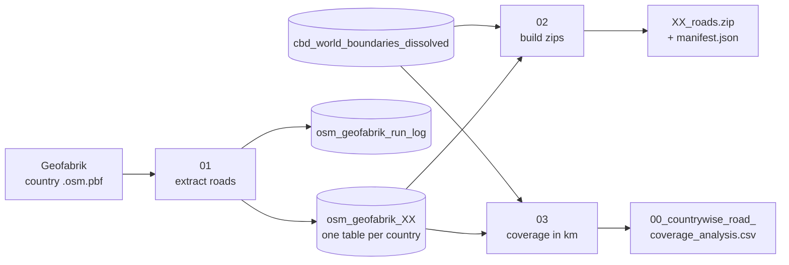

# OSM Roads by Country using Geofabrik

Three Databricks notebooks that turn OpenStreetMap country extracts from [Geofabrik](https://download.geofabrik.de) into data that is ready to use:

| Step | Notebook | Result |
|---|---|---|
| 1 | [`01_osm_geofabrik_roads.py`](01_osm_geofabrik_roads.py) | One Unity Catalog table of road lines per country |
| 2 | [`02_osm_roads_build_zips.py`](02_osm_roads_build_zips.py) | One downloadable zip of CSV files per country, plus a `manifest.json` that lists them |
| 3 | [`03_osm_roads_coverage_analysis.py`](03_osm_roads_coverage_analysis.py) | One CSV with the road length in km for every country, split by road kind |

Run them in this order. Notebooks 02 and 03 both read the tables that notebook 01 creates.

---

## Contents

- [Pipeline at a glance](#pipeline-at-a-glance)
- [What it produces](#what-it-produces)
- [Requirements](#requirements)
- [Quick start](#quick-start)
- [Notebook 01: extract roads into tables](#notebook-01-extract-roads-into-tables)
- [Notebook 02: build one zip per country](#notebook-02-build-one-zip-per-country)
- [Notebook 03: road coverage in km](#notebook-03-road-coverage-in-km)
- [Shared extracts](#shared-extracts)
- [Refreshing the data](#refreshing-the-data)
- [Troubleshooting](#troubleshooting)
- [Known limitations](#known-limitations)

---

## Pipeline at a glance



`XX` is the lower-case ISO 3166-1 alpha-2 country code (for example `la` for Laos).

The boundary table is only used for countries that Geofabrik ships inside a multi-country extract. See [Shared extracts](#shared-extracts).

---

## What it produces

| Output | Location | Written by |
|---|---|---|
| Country tables | `prd_mega.sgpbpi163.osm_geofabrik_<iso2>` | 01 |
| Run log | `prd_mega.sgpbpi163.osm_geofabrik_run_log` | 01 |
| Cached Geofabrik downloads | `/Volumes/prd_mega/sgpbpi163/vgpbpi163/OSM/geofabrik_country/<name>-latest.osm.pbf` | 01 |
| Country zips | `/Volumes/prd_mega/sgpbpi163/vgpbpi163/OSM/osm_road_all_country/<iso2>_roads.zip` | 02 |
| Manifest | `/Volumes/prd_mega/sgpbpi163/vgpbpi163/OSM/osm_road_all_country/manifest.json` | 02 |
| Coverage CSV | `/Volumes/prd_mega/sgpbpi163/vgpbpi163/OSM/geofabrik_country/00_countrywise_road_coverage_analysis.csv` | 03 |

---

## Requirements

**Databricks**
- A Unity Catalog workspace. The notebooks use catalog `prd_mega`, schema `sgpbpi163` and volume `vgpbpi163`.
- Privileges: `USE CATALOG` on `prd_mega`; `USE SCHEMA`, `CREATE TABLE`, `MODIFY` and `SELECT` on `prd_mega.sgpbpi163`; `READ VOLUME` and `WRITE VOLUME` on `prd_mega.sgpbpi163.vgpbpi163`.
- Enough local disk on the driver. Notebook 01 copies each country's `.osm.pbf` there to parse it, and the largest countries are several GB. Notebooks 02 and 03 work from the tables, not the PBFs.

**Network** (notebook 01 only)
- Outbound HTTPS to `download.geofabrik.de`.
- `wget` on the cluster, which Databricks Runtime provides.

**Input table** (notebooks 02 and 03)
- `prd_mega.sgpbpi163.cbd_world_boundaries_dissolved` with the columns `iso_a3` and `geometry_json` (GeoJSON). It holds the World Bank official country boundaries.

**Python packages**

The first cell of each notebook installs what it needs:

| Notebook | Packages |
|---|---|
| 01 | `osmium` |
| 02 | `numpy<2`, `shapely` |
| 03 | `numpy<2`, `shapely`, `pyproj` |

All settings are plain constants in the **Settings** cell of each notebook. There are no widgets.

---

## Quick start

1. **Get the notebooks into Databricks.** Add this repository as a Git folder, or use *Workspace → Import → File* for each `.py` file. They open as notebooks.
2. **Smoke test on two countries.** In each notebook set `ONLY_ISO2 = ["LA", "BT"]` and run 01, then 02, then 03.
3. **Check the results.**
   - 01 prints `SUCCESS` per country and writes the run log.
   - 02 prints the zip it published and ends with `N of N zips look right`.
   - 03 ends with `CSV check passed`.
4. **Run everything.** Set `ONLY_ISO2 = []` in all three notebooks and run them as a Databricks Job:
   - *Workflows → Create job*, with three notebook tasks.
   - Task 01 first. Tasks 02 and 03 each depend on 01 and can run in parallel.
5. **Re-run any time.** Every notebook is safe to run again. See [Refreshing the data](#refreshing-the-data).

> Notebook 03 overwrites its CSV on every run. A smoke test with `ONLY_ISO2` therefore replaces the full file with just those countries.

---

## Notebook 01: extract roads into tables

`01_osm_geofabrik_roads.py` downloads each country's Geofabrik extract and stores its roads in a Unity Catalog table.

For every country in `COUNTRIES` it:

1. **Skips** the country if `prd_mega.sgpbpi163.osm_geofabrik_<iso2>` already exists. Nothing is logged for a skipped country.
2. **Finds the extract.** The list holds the Geofabrik folder and file name for each country, giving `https://download.geofabrik.de/<folder>/<name>-latest.osm.pbf`. Countries without an entry of their own are looked up in Geofabrik's index by ISO-2 code. If Geofabrik has no extract, the country is logged as a failure.
3. **Downloads** the `.osm.pbf` with `wget` into the Volume folder `.../OSM/geofabrik_country/`. A file that is already there is reused, so each extract is downloaded once. It is copied to local disk for parsing.
4. **Extracts the roads in one pass** with pyosmium. Every way with a `highway` tag in the list below is kept, and its line is built as WKT text while parsing.
5. **Appends the rows to the table in chunks** of 200,000 rows, so memory use stays flat for large countries.
6. **Logs** success or failure to `osm_geofabrik_run_log`.

The loop never stops on an error. A failed country is logged and the next one starts.

**Road types kept** (`highway=` values):

`motorway`, `trunk`, `primary`, `secondary`, `tertiary`, `unclassified`, `residential`, `service`, `motorway_link`, `trunk_link`, `primary_link`, `secondary_link`, `tertiary_link`, `living_street`, `track`, `road`.

Footways, paths, cycleways, pedestrian streets, steps and bridleways are not included.

**Countries.** `COUNTRIES` lists 234 ISO codes. 205 have a Geofabrik path of their own and 29 are looked up in Geofabrik's index. `AN` (Netherlands Antilles) and `CS` (Serbia and Montenegro) no longer exist as ISO codes and are logged as failures.

### Country table

`prd_mega.sgpbpi163.osm_geofabrik_<iso2>`

| Column | Type | Description |
|---|---|---|
| `osm_id` | BIGINT | OSM way id |
| `name` | STRING | `name=` tag, null if the way has none |
| `kind` | STRING | The `highway=` value, e.g. `residential`, `tertiary`, `track` |
| `geometry` | STRING | `LINESTRING (lon lat, lon lat, ...)` in WGS84 (EPSG:4326), 7 decimals |
| `source_year` | BIGINT | The calendar year in which the notebook ran |

### Run log

`prd_mega.sgpbpi163.osm_geofabrik_run_log` has one row per success or failure.

| Column | Description |
|---|---|
| `run_ts` | When the row was written (UTC) |
| `iso2`, `country_name` | The country |
| `status` | `success` or `failure` |
| `uc_table` | The table written (success only) |
| `row_count` | Number of roads written (success only) |
| `reason` | Error text (failure only) |
| `note` | For example a shared-extract warning |

Latest status per country:

```sql
SELECT iso2, country_name, status, row_count, reason, note, run_ts
FROM (
  SELECT *, ROW_NUMBER() OVER (PARTITION BY iso2 ORDER BY run_ts DESC) AS rn
  FROM prd_mega.sgpbpi163.osm_geofabrik_run_log)
WHERE rn = 1
ORDER BY status, iso2;
```

### Settings

| Setting | Default | Meaning |
|---|---|---|
| `CATALOG`, `SCHEMA`, `TABLE_PREFIX` | `prd_mega`, `sgpbpi163`, `osm_geofabrik_` | Where the tables are created |
| `VOLUME_DIR` | `/Volumes/prd_mega/sgpbpi163/vgpbpi163/OSM/geofabrik_country/` | Where the downloaded PBFs are cached |
| `FORCE_DOWNLOAD` | `False` | `True` downloads again even if the PBF is in the Volume. Geofabrik rebuilds `-latest` daily. |
| `CHUNK_ROWS` | `200_000` | Rows buffered before each append to the table |
| `BIG_PBF_BYTES` | 500 MB | Larger files use a node-location index on disk instead of RAM |
| `ONLY_ISO2` | `[]` | Smoke test: list ISO-2 codes to process only those. Empty means all countries. |

---

## Notebook 02: build one zip per country

`02_osm_roads_build_zips.py` turns every country table into a download for a web app.

```
/Volumes/prd_mega/sgpbpi163/vgpbpi163/OSM/osm_road_all_country/
    vn_roads.zip       road_openstreetmap_vn_part00001.csv, ..._part00002.csv, ...  +  README.txt
    ...
    manifest.json      what is available: name, rows, parts, size, columns, dates
```

For every `osm_geofabrik_<iso2>` table it:

1. **Skips** the country when its zip is up to date. That means the table has not been rewritten since the last build, the build settings are the same, and the zip is still in the Volume.
2. **Clips shared extracts.** For countries that Geofabrik ships inside a multi-country extract, only the roads that touch the country's World Bank boundary are kept. See [Shared extracts](#shared-extracts).
3. **Writes CSV parts with Spark.** Each part has at most 200,000 rows. Rows are spread evenly in no particular order, so users must append all parts. Line breaks inside text values are replaced by a space, and quotes follow RFC 4180.
4. **Zips and checks.** The parts are zipped on local disk with a `README.txt`. The row count of every part is checked against the table before the zip is published.
5. **Publishes safely.** The zip is copied to the Volume under a temporary name and then renamed, so the app never sees a half-written file.
6. **Updates `manifest.json` after every country**, so the app sees each new file as soon as it is ready.

A failed country is reported and the loop continues. Its previous zip, if any, stays published.

At the end the notebook opens every published zip and confirms its file names match the manifest.

### CSV columns

The CSVs have the same columns as the country table: `osm_id`, `name`, `kind`, `geometry`, `source_year`.

### Manifest

`manifest.json` has `manifest_version`, `updated_at`, `rows_per_part` and a `countries` object keyed by ISO-2 code. Each country entry holds:

| Field | Meaning |
|---|---|
| `iso2`, `name` | The country |
| `file`, `size_bytes` | The zip file name and size |
| `rows`, `parts` | Total roads and number of CSV files in the zip |
| `columns` | Column names of the CSVs |
| `table` | Source table |
| `extracted_at`, `built_at` | When the table was last written, and when the zip was built |
| `extract`, `shared_extract`, `clipped` | The Geofabrik extract, whether it covers several countries, and whether it was clipped |
| `table_fingerprint`, `build_settings` | Used to decide whether the zip is up to date |

### Settings

| Setting | Default | Meaning |
|---|---|---|
| `OUT_DIR` | `/Volumes/prd_mega/sgpbpi163/vgpbpi163/OSM/osm_road_all_country` | Where zips and the manifest go |
| `ROWS_PER_PART` | `200_000` | Hard limit of rows per CSV file |
| `TARGET_ROWS_PER_PART` | `195_000` | Sets the number of parts. The head-room keeps every part under the limit. |
| `ZIP_COMPRESSION_LEVEL` | `6` | |
| `CLIP_SHARED_EXTRACTS` | `True` | Clip shared extracts to the country boundary |
| `BOUNDARY_TABLE` | `prd_mega.sgpbpi163.cbd_world_boundaries_dissolved` | Boundaries (`iso_a3`, `geometry_json`) |
| `CLIP_BUFFER_DEG` | `0.002` | About 200 m. Keeps coastal roads and causeways the boundary line just misses. |
| `BOUNDARY_SIMPLIFY_DEG` | `0.0005` | About 50 m. Keeps the boundary small enough to ship to the executors. |
| `ON_MISSING_BOUNDARY` | `"keep_unclipped"` | If a boundary is missing, publish the whole shared extract and say so in the zip's `README.txt`. `"fail"` skips the country instead. |
| `FORCE_REBUILD` | `False` | `True` rebuilds every zip even if it is up to date |
| `PRUNE_MISSING_ZIPS` | `True` | Drop manifest entries whose zip is no longer in the Volume |
| `BUILD_VERSION` | `1` | Increase it when the zip layout or README changes. It forces a rebuild. |
| `ONLY_ISO2` | `[]` | Smoke test, as in notebook 01 |

---

## Notebook 03: road coverage in km

`03_osm_roads_coverage_analysis.py` measures how many kilometres of road each country has, split by road kind, and writes one CSV:

`/Volumes/prd_mega/sgpbpi163/vgpbpi163/OSM/geofabrik_country/00_countrywise_road_coverage_analysis.csv`

For every `osm_geofabrik_<iso2>` table it:

1. **Loads the table as a Spark DataFrame.** Shared extracts are clipped to the country boundary with the same rule as notebook 02, so the km match the rows people download.
2. **Adds the column `kms`**, the length of each road line in kilometres (see [How the length is measured](#how-the-length-is-measured)).
3. **Groups the roads by `kind`** and sums `kms`.
4. **Keeps the small per-country result** and moves on. A failed country is reported and left out of the CSV. It never stops the loop.

After the loop the results are combined into one Spark DataFrame with **one row per country**.

### CSV columns

| Column | Description |
|---|---|
| `country_iso2` | ISO-2 code |
| `country_name` | Country name |
| `total_coverage_km` | Sum over **all** kinds |
| `primary_km`, `secondary_km`, `tertiary_km` | Always present, right after the total |
| `<kind>_km` | One column for every other kind found in any country, biggest first: `residential_km`, `service_km`, `track_km`, `tertiary_link_km`, ... |

- A kind that a country does not have is `0`. A country with no primary roads gets `primary_km = 0`.
- If no country has `primary`, `secondary` or `tertiary`, those columns still exist and hold `0`.
- A column exists for every kind found in any table, so none is left out. Notebook 01 keeps 16 road types, so expect up to 16 kind columns.
- Values are in km with 3 decimals (1 m), written as plain decimals.
- A country whose table has no roads gets a row of zeros.

```python
import pandas as pd

df = pd.read_csv(
    "/Volumes/prd_mega/sgpbpi163/vgpbpi163/OSM/geofabrik_country/00_countrywise_road_coverage_analysis.csv",
    keep_default_na=False,   # otherwise pandas reads Namibia's code "NA" as missing
)
```

### How the length is measured

Each road is a WKT `LINESTRING` of (lon, lat) points. For every pair of consecutive points the notebook computes the shortest distance on the WGS84 ellipsoid with `pyproj.Geod(ellps="WGS84").inv(...)` and adds the segments up. The result is a true ground distance, not a length in degrees or in a flat map projection. Lines that cross the 180° meridian are handled correctly. Parts of a multi-part line are measured separately.

References:
- Karney, C. F. F. (2013), [Algorithms for geodesics](https://link.springer.com/article/10.1007%2Fs00190-012-0578-z), *Journal of Geodesy* 87, 43–55
- [GeographicLib: Geodesics on an Ellipsoid](https://geographiclib.sourceforge.io/geod.html)
- [pyproj `Geod` documentation](https://pyproj4.github.io/pyproj/stable/api/geod.html)

### How `kind` is cleaned

Before grouping, `kind` is trimmed and lower-cased, and every run of characters that is not a letter or digit becomes `_`. So `Tertiary-Link`, `tertiary link` and `tertiary_link` all end up in `tertiary_link_km`. A null or empty `kind` becomes `unknown`. The notebook prints every spelling it found and the kind it was merged into.

### Roads without a usable geometry

A road whose geometry is null, empty, unreadable, not a line, or has coordinates outside the valid range has no length. It is left out of the km sums and counted per country in the run output (`without usable geometry`).

### Built-in checks

- `total_coverage_km` equals the sum of all kind columns for every country.
- There is exactly one row per country and no null values.
- After writing, the CSV is read back and its header, row count and total are compared with the DataFrame.

### Settings

| Setting | Default | Meaning |
|---|---|---|
| `OUT_DIR`, `OUT_NAME` | `.../OSM/geofabrik_country`, `00_countrywise_road_coverage_analysis.csv` | Output location |
| `CLIP_SHARED_EXTRACTS`, `BOUNDARY_TABLE`, `CLIP_BUFFER_DEG`, `BOUNDARY_SIMPLIFY_DEG` | Same as notebook 02 | Keep them identical to notebook 02 so the numbers match the zips |
| `ON_MISSING_BOUNDARY` | `"fail"` | If a boundary is missing, the country is skipped and reported, because neighbouring roads would silently inflate its km. `"keep_unclipped"` uses the whole shared extract anyway. |
| `PRIORITY_KINDS` | `primary`, `secondary`, `tertiary` | Columns placed right after the total |
| `UNKNOWN_KIND` | `unknown` | Label for null or empty `kind` |
| `KM_DECIMALS` | `3` | Decimals in the CSV |
| `ONLY_ISO2` | `[]` | Smoke test. The CSV is overwritten with just these countries. |

Every country is one Spark job, so the largest ones (for example the US, India, China, Indonesia, Russia) take the longest. Notebook 03 has no skip logic and recomputes all countries on every run.

---

## Shared extracts

Geofabrik does not publish an extract for every country. Some are inside a larger extract. In notebook 01, the whole extract is written to the table of every code that uses it, so those tables also hold the neighbouring territories' roads. The run log's `note` column says so.

| Geofabrik extract | Codes that use it |
|---|---|
| `gcc-states` | AE, BH, KW, OM, QA, SA |
| `malaysia-singapore-brunei` | MY, SG, BN |
| `haiti-and-domrep` | HT, DO |
| `israel-and-palestine` | IL, PS |
| `senegal-and-gambia` | SN, GM |
| `american-oceania` | AS, GU, MP and other US Pacific territories |
| `ireland-and-northern-ireland` | IE and Northern Ireland (GB) |
| `indonesia` | ID and TL (East Timor) |

Notebooks 02 and 03 cut these back to the country's own boundary. A road is kept, **in full**, when it touches the country's World Bank boundary (buffered by about 200 m). The raw tables from notebook 01 are not clipped.

---

## Refreshing the data

| Situation | What to do |
|---|---|
| Run was interrupted, or some countries failed | Run 01 again. Countries whose table exists are skipped, and failed countries are retried. See the note below about countries that were cut off mid-run. |
| Refresh one or more countries with the latest Geofabrik data | Drop the table(s), for example `DROP TABLE prd_mega.sgpbpi163.osm_geofabrik_la`. Set `FORCE_DOWNLOAD = True` and `ONLY_ISO2 = ["LA"]` in 01, run it, then run 02 and 03. |
| Rebuild the zips only | Run 02. It rebuilds only countries whose table changed. Set `FORCE_REBUILD = True` to rebuild all. |
| Recompute the coverage CSV | Run 03. It always recomputes every country. |

If a run is killed in the middle of a country, for example the cluster is terminated, that country's partly written table remains. The next run of 01 sees the table and skips the country. Drop the table to extract it again. When a country fails normally, notebook 01 drops the partial table itself.

---

## Troubleshooting

| Symptom | Cause / fix |
|---|---|
| `Download failed (wget exit ...)` | The cluster cannot reach `download.geofabrik.de`, or the download broke. Check network access and run 01 again. |
| `No Geofabrik extract exists for ...` | Geofabrik has no extract for that code. Expected for some small territories. |
| `Obsolete ISO code ...` | `AN` and `CS` no longer exist. Expected. |
| `No road features ... found` | The extract has no ways with the road types listed above |
| A country is skipped as `exists` but looks incomplete | A run was cut off. Drop the table and run 01 again. |
| 02 or 03: `no boundary for XXX in ...cbd_world_boundaries_dissolved` | The boundary table has no row for that `iso_a3`. 02 publishes the whole extract and notes it (a warning). 03 skips the country (an error). Add the boundary and re-run. |
| 02: `Row check failed` or `A part has ... rows` | The CSV parts do not add up to the table. The previous zip stays published. Re-run 02 for that country with `FORCE_REBUILD = True`. |
| 03: a country is missing from the CSV | It failed. The run summary lists it under `FAILED` with the reason. |
| 03: the CSV has only a few countries | `ONLY_ISO2` was set. Clear it and run again. |
| Local disk full in 01 | The PBF of a large country does not fit on the driver. Use a cluster with more local disk. |

---

## Known limitations

- **Snapshot date.** Data is as of the day the Geofabrik extract was built. The Volume keeps the PBF it downloaded first, so with `FORCE_DOWNLOAD = False` the data can be older than today's `-latest`. `source_year` is the year the notebook ran, not the year of the data.
- **Roads only.** Only the 16 road types listed under [Notebook 01](#notebook-01-extract-roads-into-tables) are kept.
- **Border roads.** A road that crosses a border can be counted for both neighbouring countries. The boundary clip in notebooks 02 and 03 keeps whole roads that touch the boundary instead of cutting them at the border.
- **Northern Ireland.** The raw `IE` table from notebook 01 includes Northern Ireland, because it comes from a shared extract. Notebooks 02 and 03 clip `IE` to the Republic of Ireland.
- **Distances are along the ground.** Lengths ignore elevation and are measured on the ellipsoid.
- **Countries without an extract.** Some small territories have no Geofabrik extract. They are logged as failures in 01 and do not appear in the outputs of 02 and 03.

---

*Data © OpenStreetMap contributors, available under the [Open Database License (ODbL)](https://www.openstreetmap.org/copyright). Extracts are provided by [Geofabrik](https://download.geofabrik.de). Outputs derived from OSM must carry this attribution.*